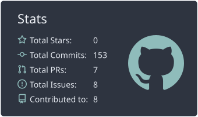
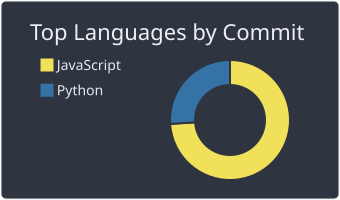
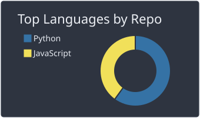
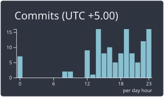

<!-- ===================================================================
  GitHub profile README for sana-uzumaki
  Theme: Dark Navy (#0B1220 / #0F1B33) + Teal (#14B8A6 / #2DD4BF)
  Search for "TODO" to find every placeholder that still needs a real value.
==================================================================== -->

 

> **Curiosity creates the problem. Logic creates the solution. Bugs create the character.**

 

<!-- TODO: replace the Codeforces, LinkedIn and Contact Me URLs above.
     Contact Me can point to a contact form, a mailto-free scheduling page, or a section of your portfolio,
     so your email address is never printed in this file. -->

 

---

## About Me

I'm a Computer Science student who enjoys building software and solving problems through code.

I spend most of my time learning by building projects, improving my problem-solving skills, and exploring different areas of software development. Recently, I've been focused on web development, backend systems, and writing code that is simple, efficient, and practical.

I enjoy turning ideas into working projects and continuously pushing myself to learn something new every day.

> **Learning by building. Growing by solving.**

---

## Technical Skills

<table>
  <tr>
    <td width="200"><b>Languages</b></td>
    <td>
      
      
      
      
      
    </td>
  </tr>
  <tr>
    <td><b>Frontend Development</b></td>
    <td>
      
      
      
      
    </td>
  </tr>
  <tr>
    <td><b>Backend Development</b></td>
    <td>
      
      
      
    </td>
  </tr>
  <tr>
    <td><b>Databases</b></td>
    <td>
      
      
    </td>
  </tr>
  <tr>
    <td><b>Tools &amp; Platforms</b></td>
    <td>
      
      
      
      
      
    </td>
  </tr>
</table>

---

## Interests and Focus Areas

- Artificial Intelligence and Machine Learning
- Full-stack Web Development
- Cloud Computing and DevOps
- Data Structures and Algorithms

---

## Currently

<table>
  <tr>
    <td width="33%" valign="top">
      <b>Working On</b>
      <ul>
        <li>Building full-stack projects with the help of AI</li>
        <li>Developing practical software applications</li>
      </ul>
    </td>
    <td width="33%" valign="top">
      <b>Learning</b>
      <ul>
        <li>Electronics and hardware-based mini projects</li>
        <li>New technologies through hands-on experimentation</li>
      </ul>
    </td>
    <td width="33%" valign="top">
      <b>Looking For</b>
      <ul>
        <li>Open-source contributions</li>
        <li>Internship opportunities</li>
        <li>Collaborative development projects</li>
        <li>Opportunities to learn and work with other developers</li>
      </ul>
    </td>
  </tr>
</table>

---

## Featured Projects

<table>
  <tr>
    <td width="50%" valign="top">
      <h3>Oil Spill Detection &amp; Maritime Intelligence</h3>
      
Team-based hackathon project focused on detecting oil spills and supporting maritime intelligence.

      
<b>Tech stack:</b> TODO: add actual technologies 
      <b>Repository:</b> <!-- TODO --> <a href="https://github.com/sana-uzumaki/YOUR-REPO-NAME">Add link</a>

    </td>
    <td width="50%" valign="top">
      <h3>Digital Risk Protection Platform</h3>
      
Team-based hackathon project focused on identifying fake social media profiles, impersonation accounts, fraudulent company pages, and scam accounts across multiple platforms.

      
<b>Tech stack:</b> TODO: add actual technologies 
      <b>Repository:</b> <!-- TODO --> <a href="https://github.com/sana-uzumaki/Anti-brand-project">Anti-brand-project</a> 
      <b>Live demo:</b> <a href="https://anti-brand-project.vercel.app/">anti-brand-project.vercel.app</a>

    </td>
  </tr>
  <tr>
    <td width="50%" valign="top">
      <h3>Todo List Website</h3>
      
Personal web development project for task management and productivity.

      
<b>Tech stack:</b> TODO: confirm actual technologies 
      <b>Repository:</b> <!-- TODO --> <a href="https://github.com/sana-uzumaki/Todo-List">Todo-List</a> 
      <b>Live demo:</b> <!-- TODO --> <a href="https://sana-todo-list.vercel.app/">sana-todo-list.vercel.app</a>

    </td>
    <td width="50%" valign="top">
      <h3>Personal Portfolio Website</h3>
      
A portfolio showcasing my development skills and projects.

      
<b>Tech stack:</b> TODO: confirm actual technologies 
      <b>Repository:</b> <!-- TODO --> <a href="https://github.com/sana-uzumaki/sana-portfolio">sana-portfolio</a>  
      <b>Live demo:</b> <a href="https://sana-codehub.vercel.app/">sana-codehub.vercel.app</a>

    </td>
  </tr>
</table>

---

## GitHub Statistics

<picture>
  
</picture>
<picture>
  
</picture>

 

  

<!--  -->

<!-- The four SVG cards above are generated by .github/workflows/profile.yml and appear after the first run. -->

### LeetCode

---

### Contact Me

---

**Learning by building. Growing by solving.**

Thanks for stopping by. Feel free to explore my projects or reach out about collaborations.

